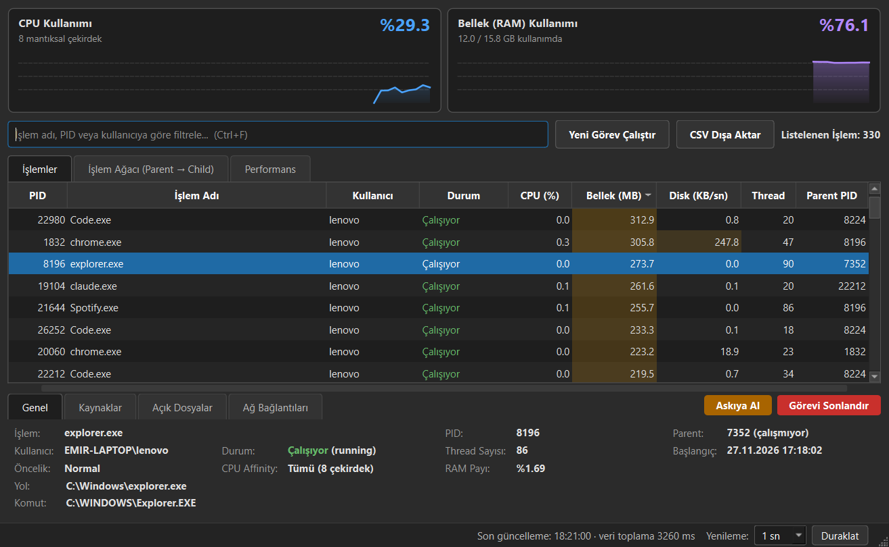

# COME 361 - Operating Systems Term Project
## Process & System Performance Monitor (Mini Task Manager)



### Group Members
* Emir Sanal
* Tuna Çakmur
* Berke Çelik
* Yağmur Şimşek

### Team Responsibilities

# Tuna Çakmur - Process Management
* List all running processes.
* Retrieve and display Process IDs (PID).
* Start new processes.
* Terminate selected processes.
* Implement process management functions using Python and `psutil`.

# Berke Çelik - System Monitoring
* Monitor real-time CPU usage.
* Monitor RAM usage.
* Collect process statistics.
* Update system performance data periodically.

# Emir Sanal – GUI Development
* Design the Task Manager interface.
* Create the process table.
* Implement buttons and user interactions.
* Add process searching and sorting features.

# Yağmur Şimşek – OS Integration & Testing
* Research operating system APIs.
* Handle process states.
* Implement error handling.
* Integrate all project modules.
* Test the application and fix integration issues.

## Project Demos

### Windows Demos

**Demo 1 — 25% Progress**

Initial development stage of the Windows Task Manager.

**Demo 2 — 40% Progress**

Intermediate development stage with additional features.

**Demo 3 — 75% Progress**

Updated Windows version with improved process management and system monitoring.

**Implemented Features:**
- Process listing and PID display
- CPU and RAM monitoring
- Process searching and filtering
- Process details
- Process termination with user confirmation
- Automatic refresh every 2 seconds

**Demo Files:**
- Python source code
- Application screenshot

**Final — 100% (Task Manager Lite v1.4)**

The final version is in the [`Final/`](Final/) folder:
- `final.py` — GUI (PyQt6)
- `process_ops.py` — backend: process listing, termination, starting
- `NotFinal.txt` — notes for the team on what changed since Demo 3 (Turkish)
- `screenshot.png` — the final application

**Final Features:**
- All processes listed with PID, name, user, state, CPU %, memory, disk I/O, threads and parent PID; sortable columns and search by name, PID or user
- Process tree tab (parent → child hierarchy)
- Performance tab: per-core CPU graphs, disk and network throughput, uptime, swap, context switches and interrupts per second
- Live CPU and RAM history graphs
- Suspend / resume (SIGSTOP / SIGCONT), priority (nice) change, CPU affinity
- Termination with verification (offers force kill if the process does not exit, detects zombies); terminate a whole process tree
- Protected system processes (PID 0, 1, 4 and the app itself)
- Tabbed details panel: general info, resources, open files, network connections
- CSV export, right-click menu, keyboard shortcuts (Delete, Ctrl+F, F5, Ctrl+S)
- Data collection runs on a background thread, so the interface never freezes

### Current Status

The project is complete. The final version has been tested on Windows; macOS and Linux have not been tested yet.

### Description
A GUI-based system performance and process management tool written in Python using `PyQt6` and `psutil`.

### Prerequisites
* Python 3.x
* PyQt6
* psutil

### How to Run
1. Install dependencies:
   ```bash
   pip install PyQt6 psutil
   ```
2. Run the final version:
   ```bash
   python Final/final.py
   ```
