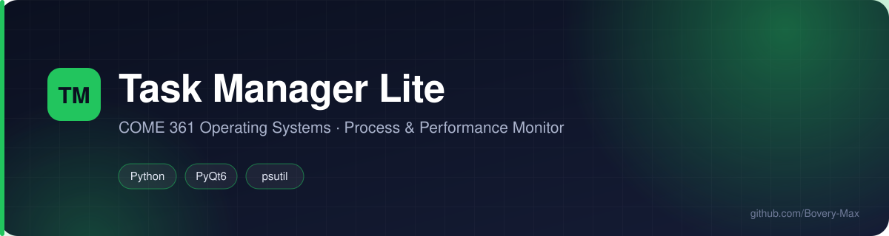
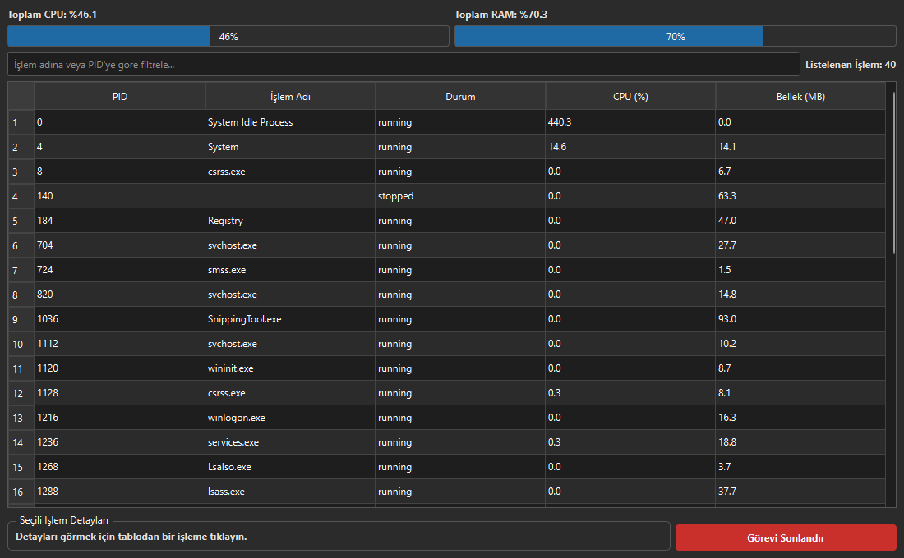

<div align="center">



<br/><br/>

<p><b>A desktop process &amp; performance monitor — COME 361 Operating Systems term project at Doğuş University.</b></p>


<br/><br/>

<p>
<a href="#-features">Features</a> ·
<a href="#-getting-started">Getting started</a> ·
<a href="#-project-layout">Layout</a> ·
<a href="#-team">Team</a> ·
<a href="#-status">Status</a>
</p>

</div>



## 📋 Overview

Task Manager Lite lists every running process, shows live CPU and RAM usage, and lets you start, suspend, resume and terminate processes — with guard rails so you cannot kill the system or the app itself. Data collection runs in its own thread, so the window never freezes while refreshing.

## ✨ Features

<table>
  <tr>
    <td align="center" width="33%"><h3>📋</h3><b>Full process table</b><br/><sub>PID, name, state, CPU %, memory, parent PID and user. Click a header to sort.</sub></td>
    <td align="center" width="33%"><h3>🔍</h3><b>Live search</b><br/><sub>Filter by name or PID as you type; the footer shows <i>visible / total</i>.</sub></td>
    <td align="center" width="33%"><h3>📈</h3><b>CPU &amp; RAM graphs</b><br/><sub>Real-time charts, refresh every 1 / 2 / 5 / 10 s or pause.</sub></td>
  </tr>
  <tr>
    <td align="center"><h3>🎛️</h3><b>Process control</b><br/><sub>Start (with arguments), suspend / resume, terminate with confirmation and force-kill fallback.</sub></td>
    <td align="center"><h3>🛡️</h3><b>Guard rails</b><br/><sub>PID 0, 1, 4 and the app itself are protected. Zombies are reported.</sub></td>
    <td align="center"><h3>🧵</h3><b>Non-blocking UI</b><br/><sub>Sampling happens on a worker thread; the selection survives refreshes.</sub></td>
  </tr>
</table>

Also: colour-coded states (Running, Sleeping, Stopped, Zombie) and a details panel with parent name, user, thread count, state and start time.

## 🚀 Getting started

Requires Python 3.x.

```bash
pip install PyQt6 psutil
python main.py
```

`main.py` is the current Windows build. The macOS build lives in `macOS demo/`:

```bash
cd "macOS demo"
python taskmanager.py
```

## 🗂️ Project layout

```
main.py               current Windows build (PyQt6)
macOS demo/
  taskmanager.py      macOS UI
  process_ops.py      list / start / terminate helpers
demo1windows/         Demo 1 · 25 % — first Tkinter prototype
demo2windows/         Demo 2 · 40 % — Tkinter with more features
demo3windows/         Demo 3 · 75 % — PyQt6 rewrite
docs/                 README images
```

Each demo folder holds the code shown at that milestone and a short note (`Not*.txt`, in Turkish) describing what changed.

## 👥 Team

| Member | Responsibility |
|---|---|
| **Tuna Çakmur** | Process management — listing, PIDs, start and terminate with `psutil` |
| **Berke Çelik** | System monitoring — CPU and RAM sampling, periodic updates |
| **Emir Sanal** | GUI — table, buttons, search and sorting |
| **Yağmur Şimşek** | OS integration and testing — process states, error handling, integration |

## 🚧 Status

Windows build is at the Demo 3 stage. macOS build is in progress; cross-platform testing is next. If it fails on your machine, open an issue with the traceback.

---

<div align="center">
<sub>Doğuş University · COME 361 Operating Systems · 2026</sub>
</div>
